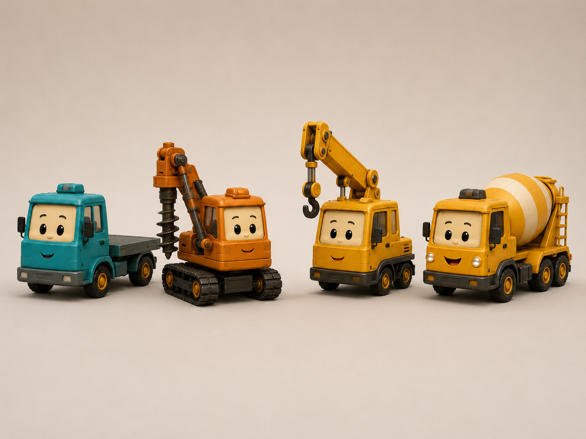
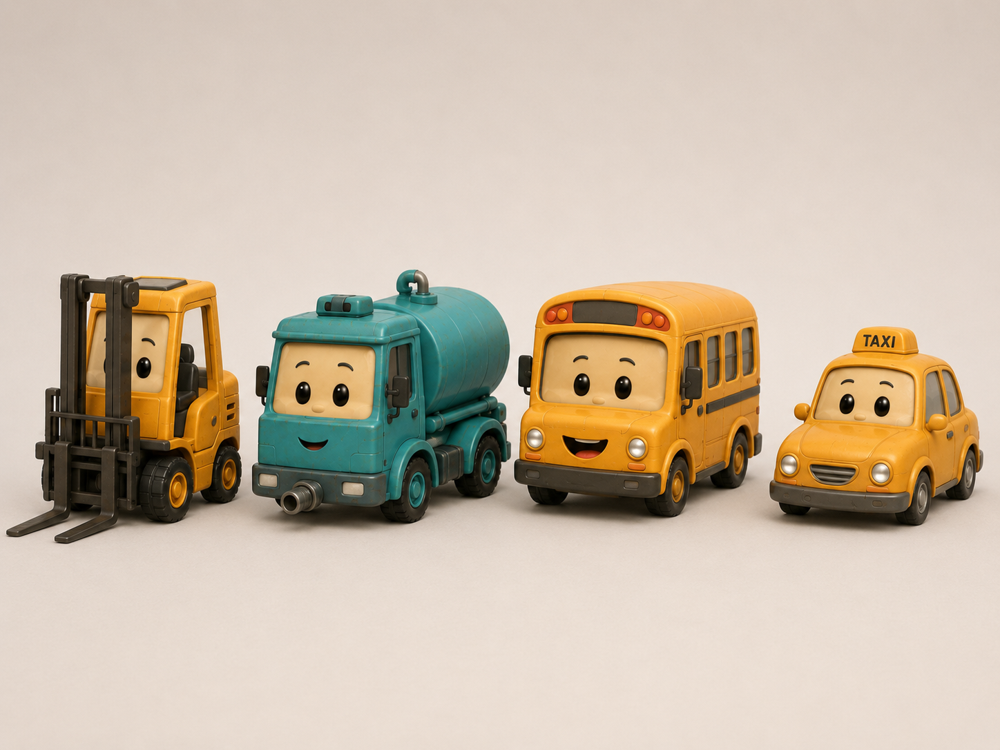
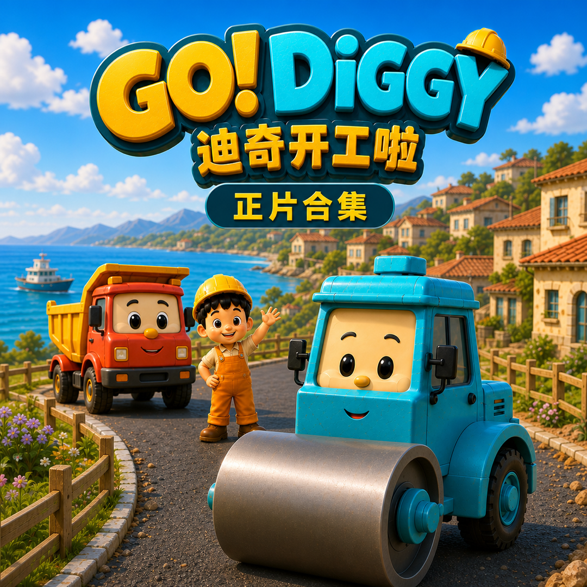
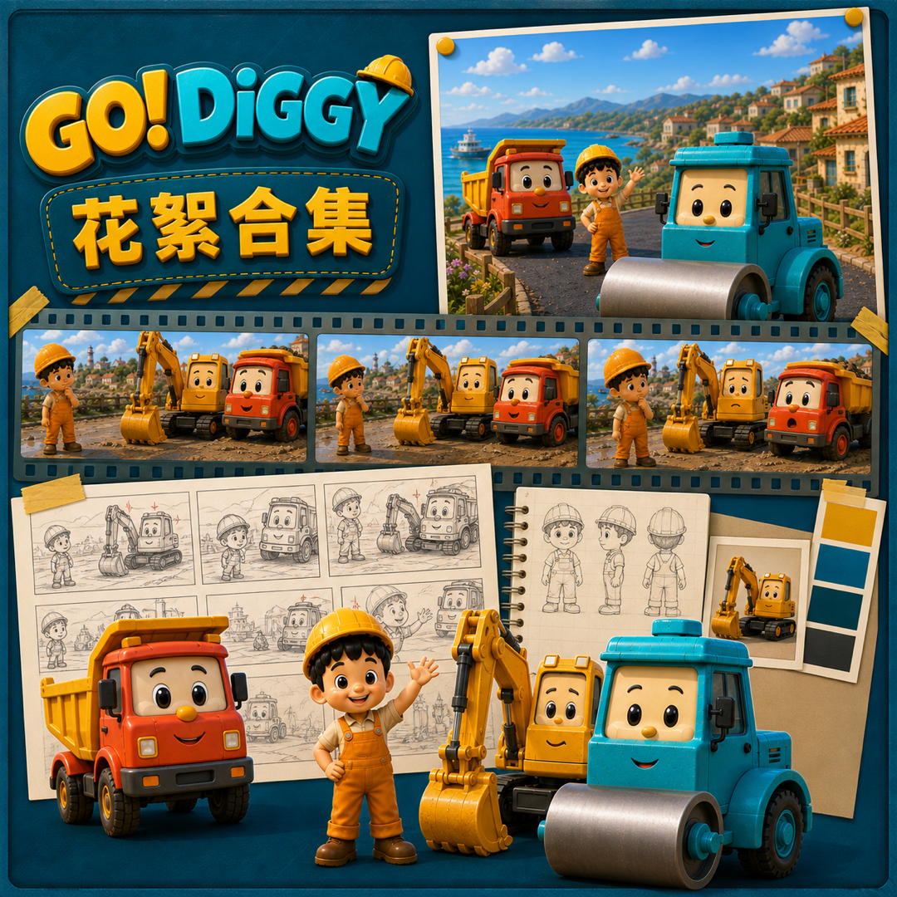
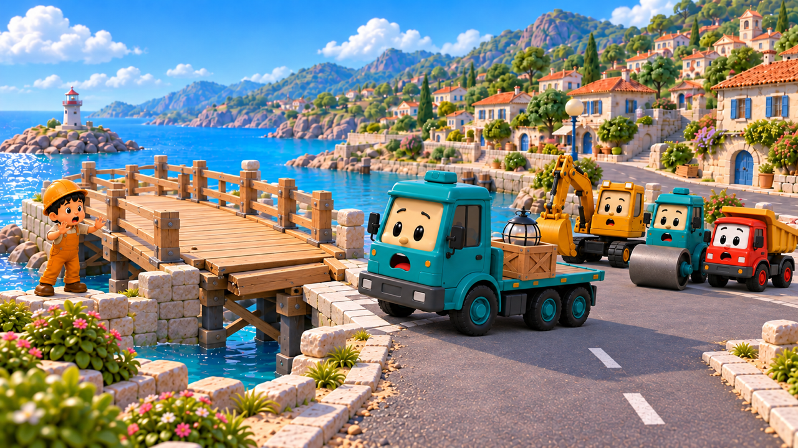
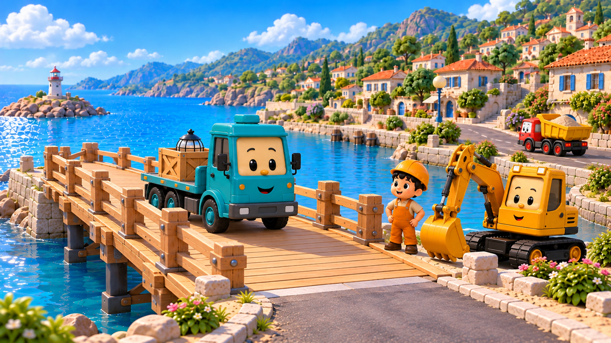
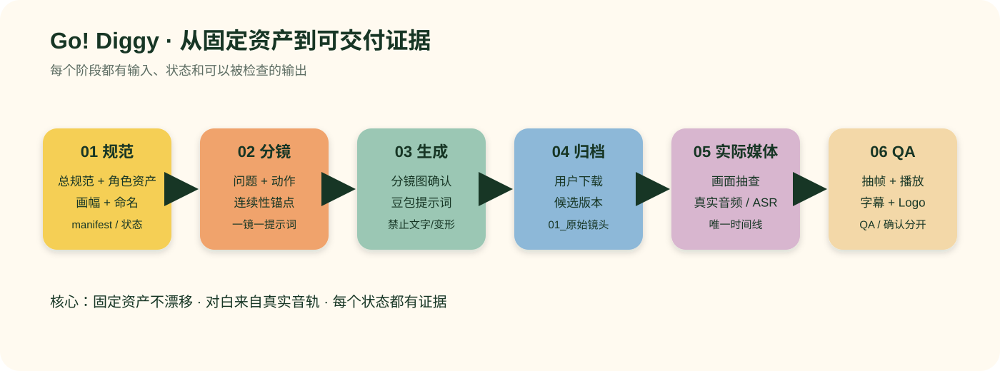

# Go! Diggy Animation Production

把 Go! Diggy 的制作经验整理成一个可复用、可审计的 Agent Skill：从已确认的人物/车辆素材出发，完成分镜、逐镜提示词、豆包素材交接、真实音频字幕、720p 导出与证据化 QA。


## 先看动画宣传片

点击封面查看中文版30秒宣传片，也可下载英文版。这里使用项目已有的 v05 宣传片文件。

[](https://github.com/AILateststudio/go-diggy-animation-production/raw/refs/heads/main/demo/go-diggy-promo-zh.mp4)

[中文版 MP4](demo/go-diggy-promo-zh.mp4) · [English MP4](demo/go-diggy-promo-en.mp4)

## 固定人物素材：系列一致性的起点

这些是项目既有的角色合照参考。公开图片用于展示制作过程；实际生成仍须读取当前角色索引，核对已确认、作废与待确认状态。


| 工程车组 A | 工程车组 B |
| --- | --- |
|  |  |

## 从正片到花絮：合集入口

| 正片合集封面实例 | 花絮合集封面实例 |
| --- | --- |
|  |  |

封面实例保留原有版本的文字与设计，用来说明项目产出。历史设计不自动成为新封面的规范。

## 横竖屏、中英文分别构图


| 中文竖版 3:4 | English portrait 3:4 |
| --- | --- |
|  |  |


## 一集如何展开：EP11《港口断桥》

使用项目 `F_当前交付_v02_桥体故障` 的14镜分镜图作为案例。这是分镜设计示例，尚不能据此声称存在已完成的视频或真实对白。


| S04：故障前一切正常 | S05：近岸桥体突然下沉 |
| --- | --- |
|  |  |
| S10：发现桥下支撑移位 | S14：桥面稳定，灯具通过 |
|  |  |

这个案例的重点是让原因和问题一致：故障发生在桥体与支撑；故障前保持正常状态，后续才观察、发现原因并组织修复。

## 生产流程



## 它解决什么问题

AI 动画最容易出现的不是“不会生成”，而是：角色慢慢走样、镜头状态接不上、提示词被误当成对白、候选被误报成交付，以及修完却没有证据。

这个 Skill 把生产过程拆成可复现的状态和证据：

| 文章里的方法 | Go! Diggy 的落地方式 |
| --- | --- |
| 设计稿是唯一规格书 | 已确认人物/车辆素材是固定资产；只改变场景、动作、表情、站位和机位 |
| 参数化、可修改、可复现 | 用单集 manifest、逐镜提示词、唯一剪辑时间线和变更记录保存版本关系 |
| 对比图与局部特写自查 | 抽帧、角色/车辆变形点、接缝与连续性特写、音频/字幕核对 |
| 不接受没有证据的“已修复” | 每个 QA 状态都必须绑定文件、样帧、播放或听辨证据 |
| 一套模板服务多集 | 角色命名、画幅、字幕、Logo 和交付状态由项目总规范统一，不从旧脚本复制参数 |


## 目录

```text
SKILL.md                              # Agent 入口与硬规则
references/production-experience.md  # “挖掘机经验”文章版
references/qa-checklist.md           # 分镜、素材、音频、字幕、导出 QA
references/episode-manifest.example.json
references/promo-video.md            # 宣传片视频介绍的接入约定
scripts/validate_manifest.py         # 无第三方依赖的 manifest 检查器
assets/*.svg                         # README 流程图
LICENSE                              # MIT
```

## 快速使用

1. 在目标项目中先读取当前总规范、画幅附录、固定工作流、角色参考 README、角色命名索引和对应集数执行说明。
2. 复制 `references/episode-manifest.example.json`，替换为真实的项目相对路径和状态。
3. 让 Agent 按 `SKILL.md` 生成分镜与逐镜独立提示词；不要把分镜当成成片或对白证据。
4. 用户下载并归档豆包视频后，再进行实际画面/音频审计、字幕和导出 QA。
5. 用下面的检查器先检查 manifest 结构：

```bash
python3 scripts/validate_manifest.py references/episode-manifest.example.json
```

检查器只检查记录结构与状态门槛，不会把不存在的 MP4、音频、角色图或用户确认变成“已完成”。

## 宣传片与素材来源

本次接入项目已有的中英文 v05 品牌宣传片，以及16张角色参考、合集封面、单集封面和分镜图。逐项来源、尺寸、校验值见 [素材索引](references/media-index.json)。宣传片文件已做完整解码检查；本次未进行新的完整人工听辨，不将它标为新一轮音频/字幕验收通过。后续更换宣传片时按 [promo-video.md](references/promo-video.md) 更新记录。

## 开源边界

工作方法和辅助脚本采用 MIT。`assets/gallery/` 与 `demo/` 中的 Go! Diggy 图片、角色、Logo 和视频属于作者的作品展示，保留权利，不随 MIT 授权再分发、改编或商用。仓库不包含字体文件、账号凭据和私有附件。使用者应提供自己的已授权角色素材，按 Skill 建立自己的制作流程。

## 作者与实践来源

作者：Leo Builds（[@leomadeits](https://x.com/leomadeits)）。本 Skill 整理了我在 Go! Diggy 工程车动画中的制作经验，也延续了我在 Rory & Pip 恐龙动画及 `cartoon-from-design` 中实践过的方法：把角色设计当作规格书，让修改可追溯，用实际画面和音频验证结果。

- [我写的恐龙动画制作文章](https://x.com/leomadeits/status/2113640886240457099)
- [cartoon-from-design](https://github.com/shitouxiaod/cartoon-from-design)

两个 Skill 对应我自己的两条制作路线：`cartoon-from-design` 使用矢量角色与代码渲染；本 Skill 面向 Go! Diggy 的固定角色素材、豆包视频生成与真实音频 QA。本包包含工作方法和辅助工具，角色图、Logo 与成片仍按各自授权管理。

## License

MIT，见 [LICENSE](LICENSE)。Go! Diggy 的角色、Logo、字体和成片不随本许可证授权。
