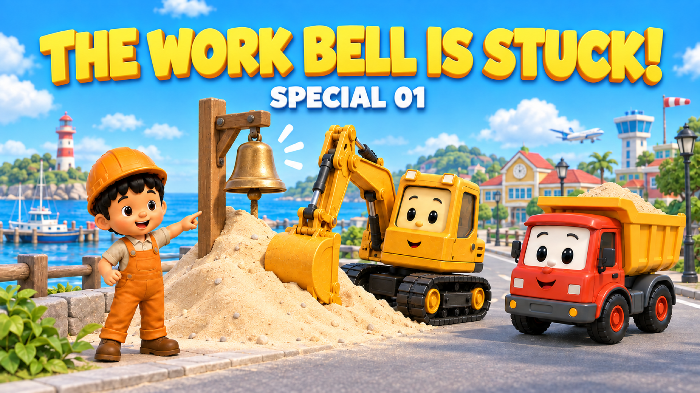
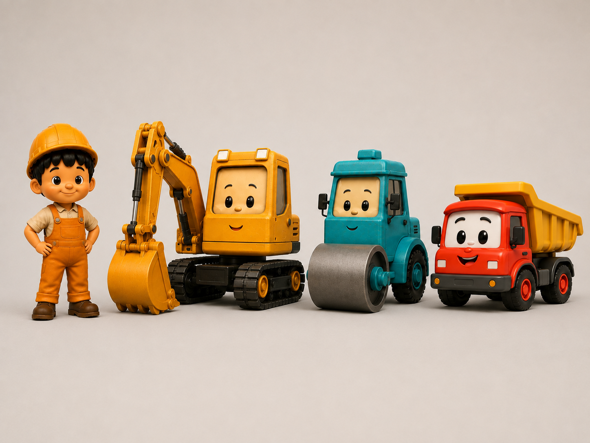
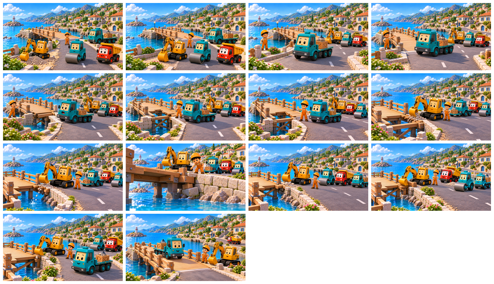
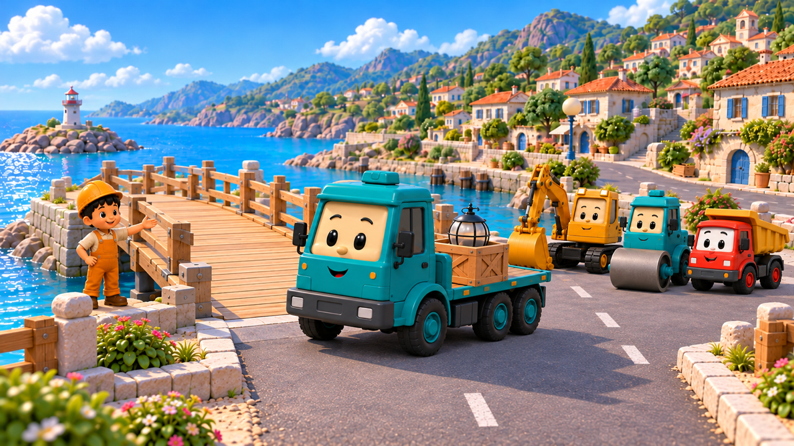
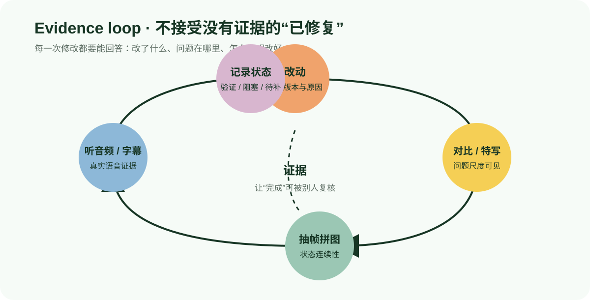
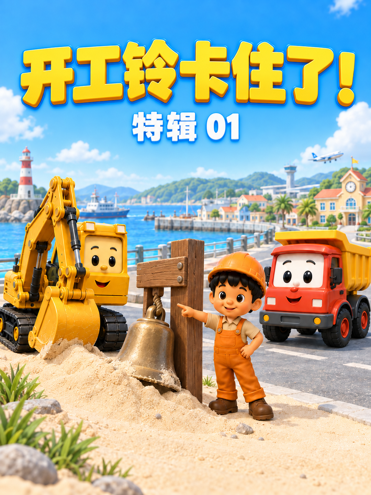
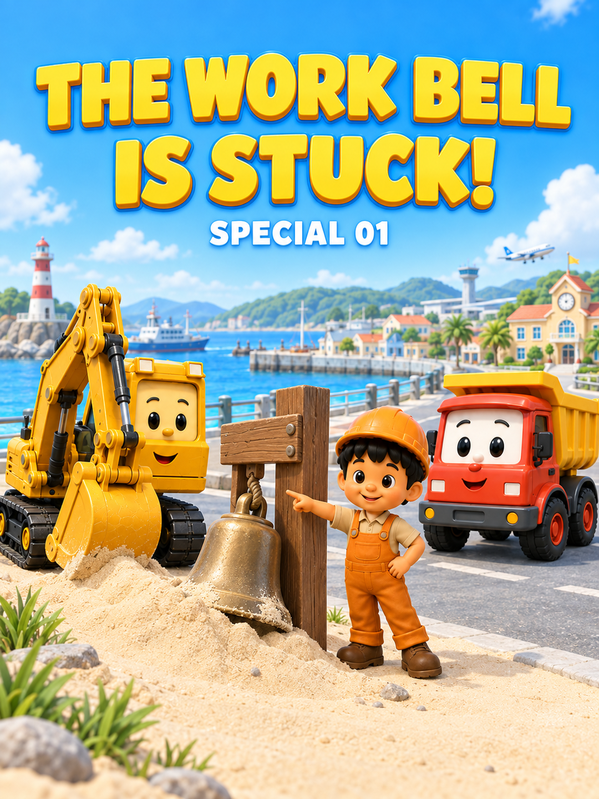
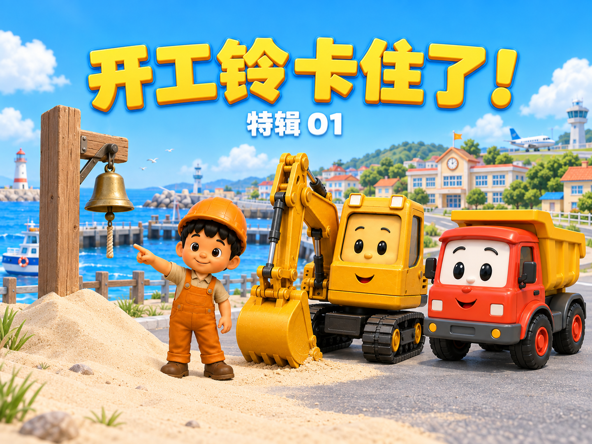
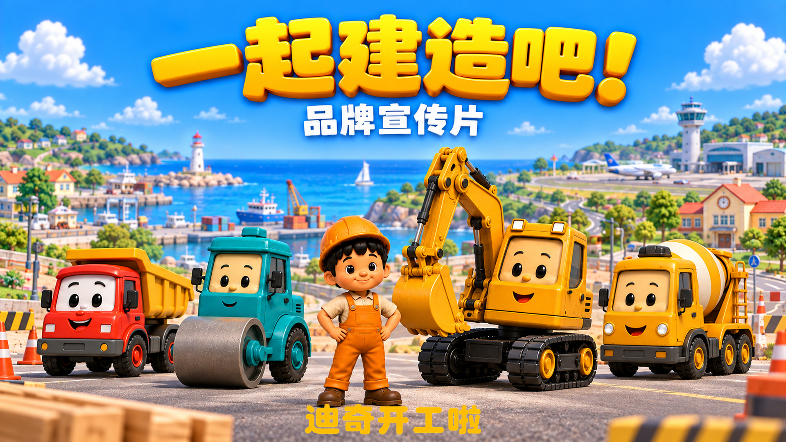

# 做 Go! Diggy 挖掘机动画后，真正留下的经验

作者：Leo Builds。本文图片取自我自己的 Go! Diggy 项目，展示角色素材、封面和分镜实践。



## 开头：动画最难的不是“生成”

做工程车动画一开始很容易被一个问题吸引：能不能让 AI 快一点生成一段漂亮的视频？但真正进入连续制作后，问题会变成另一组：

- 这一集的迪奇，下一集还是不是同一个迪奇？
- 画面里说的话，是否真的出现在音轨里？
- 这一镜生成得很漂亮，和上一镜的物体状态接得上吗？
- 说“已经修好”时，能不能拿出一张看得见问题的对比图？
- 一个候选文件、一个已导出文件、一个 QA 通过文件和用户确认文件，能不能分清？

所以，挖掘机动画真正要建立的不是一次性抽卡技巧，而是一条能重复、能检查、能交接的生产链。每一集都应该从同一套角色资产、同一套命名、同一套画幅与字幕规则出发，再根据故事改变动作和场景。

## 1. 先把设计稿当成规格书



我在 Rory & Pip 恐龙动画及上一篇文章中总结过一点：“设计稿不是灵感，而是规格书”。在 Go! Diggy 里，这个设计稿对应的是已经确认的人物和车辆素材：小本 Ben、迪奇 Diggy、罗利 Rolly、丹比 Dumpy，以及后续已经确认的工程车辆。

规格书意味着：

- 脸部位置、车身比例、主色、材质和机械结构不能为了构图方便而改掉；
- Rolly 的滚筒要保持宽而正常，不能用生成结果的透视或压窄来掩盖问题；
- Dumpy 是丹比的翻斗车类型，不把车辆类型误写成人名；
- 基础角色保持干净、可爱，剧情需要的少量环境土渍不能变成重度泥污；
- Logo 不因为“看起来更像品牌”就贴到角色本体上。

允许改变的是分镜需要改变的部分：场景、动作、表情、站位、景别和机位。只要角色本体发生变形，就不是“有一点风格变化”，而是素材不合格，应重生成或更换镜头。

## 2. 分镜图是设计意图，不是对白证据

分镜可以说明“迪奇准备挖土”“罗利压平道路”“小本发现问题”，但它不能证明角色说了哪一句话。逐镜提示词也一样：它是交给视频生成模型的动作与状态说明，不是成片的逐字台词。

这条边界非常重要。正确的关系是：

```text
故事与分镜  →  生成意图
豆包视频    →  用户下载并归档的候选素材
实际音轨    →  字幕、关键词和对白事实
最终剪辑    →  交付时间线与导出证据
```

如果视频里没有说完一句话，字幕就保留实际截断形式；不能因为脚本里写了完整句子，就替音频补台词。无声镜头可以用动作关键词帮助理解，但不能把它伪装成角色说出口的对白。

## 3. 每一个分镜都要有自己的提示词



图：EP11 桥体故障版分镜，展示正常状态、突然故障、观察原因与修桥结果；分镜不是已生成视频的证明。

“每一个分镜一个提示词”不是排版要求，而是连续性控制。一个独立提示词至少要把以下信息说清楚：

1. 哪个固定角色或车辆出现，以及参考素材是什么；
2. 它在什么地点，上一镜留下了什么物体状态；
3. 这一镜唯一的主要动作是什么；
4. 动作完成后谁反应、停顿或为下一镜铺垫；
5. 相机使用什么机位、景别和运动；
6. 台词是对白意图还是已经确认的真实台词；
7. 明确禁止文字、字幕、Logo、水印和额外角色/车辆；
8. 不得改变脸、比例、颜色、材质、轮胎、履带、滚筒、翻斗或其他固定结构。

相邻镜头要写连续性锚点：木板已经抬起还是仍在地上，水管已经破裂还是尚未破裂，车斗是空的还是装满，人物朝向是否仍在同一空间轴上。华丽的镜头运动不能抵消状态接不上这个问题。

## 4. 十秒是节奏骨架，不是硬性成片时长

Go! Diggy 的常规分镜以约十秒作为设计节奏，是为了让 3–6 岁孩子看清楚“发生了什么”，而不是为了把每个成片强行剪成相同长度。一个分镜通常可以按这样的内部节奏组织：

- 前段进入状态，让观众看到地点、角色和问题；
- 中段完成主要动作或一到两句短对白；
- 后段保留反应、停顿或下一步的铺垫。

全集故事要经历困难、第一次尝试、失败、Ben 观察/思考、重新分工、正确解决、重点角色高光和生活化收尾。少切镜、留反应时间，通常比不断换机位更能让角色“活起来”。

## 5. 真正的素材从归档时才开始

外部生成结果必须由用户下载到对应集数的 `01_原始镜头/`。在此之前，它只是生成服务里的结果，不是项目已经接入的素材。

归档后，每个候选至少要有：

- 集数、分镜号、内容短名和版本号；
- 来源分镜图与提示词路径；
- 视频是否可解码、时长、尺寸、帧率和音频轨道；
- 角色/车辆是否走样，物体和空间轴是否连续；
- 候选、已导出、QA 通过、用户确认四种状态中的当前状态。

文件名可以帮助人找文件，但不能替代检查。`final`、`latest`、较大的版本号和较新的修改时间，都不能自动变成用户确认。

## 6. 质量通常藏在接缝和小状态里

| 故障前保持正常 | 后续才揭示支撑问题 |
| --- | --- |
|  |  |

我做恐龙动画时，嘴角、下巴、尾巴根、手臂和肚子最容易暴露接缝问题。Go! Diggy 的对应问题更广：

- 角色脸、车灯脸、车窗脸和机械结构是否在镜头之间保持一致；
- 铲斗、履带、滚筒、翻斗和车轮连接处是否出现异常形状；
- 角色动作的起点和终点是否与上一镜、下一镜接上；
- 道具是被搬起、放下、打开、关闭、装满还是清空；
- 角色的视线和运动方向是否仍然符合空间轴；
- 字幕是否盖住脸、车辆关键结构或动作结果。

正常速度播放时一闪而过的问题，缩小、暂停或逐帧看就会暴露出来。抽帧拼图不是装饰，而是把连续播放中的漂移变成可以比较的证据。

## 7. 自查循环要比“已修复”更可信

每一次修改都应该回答三个问题：改了什么、问题在哪里、怎么证明改好。最小证据循环是：

1. 在能看到问题的尺度上保存修改前后对比；
2. 对变形点、接缝、角色脸和关键机械结构做局部特写；
3. 抽取开头、动作中段、反应和结尾的代表帧拼图；
4. 重新播放完整视频并听辨实际音轨；
5. 记录新文件、旧文件、变更点和当前状态。

如果只有一句“已经修复”，没有对比图、抽帧、播放或听辨记录，就只能写成“已尝试修改”，不能写成“已修复”。



## 8. 字幕从真实音频开始

字幕工作最容易被脚本带偏。正确流程是先确认视频实际有声、读出真实音轨，再进行 ASR 或人工听辨，最后逐句建立字幕时间。中文版本为英文在上、中文在下；英文版本只显示英文。普通对白和顶部关键词是两个层，关键词也要和真实语音或明确动作同步。

换镜头、变速、移动或替换音频之后，必须重新计算后续区间，并一起检查普通字幕、关键词、署名和 Logo。不能只挪一条字幕，也不能在已经烧录字幕的成片上再叠一套新的字幕。

## 9. 画幅和交付状态必须分开说

| 中文竖版合集 | 英文竖版合集 |
| --- | --- |
|  |  |



当前系列以 720p 为成片基准：横屏 1280×720，竖屏 720×1280。横屏与竖屏各有自己的字幕像素附录；竖屏旧版参数不能未经样帧验证直接复用。封面是独立图片，按语言和画幅矩阵原生构图，不用视频截图冒充封面。

一个可交付的陈述应该具体到层级：

- “分镜已写”只说明故事和镜头意图存在；
- “视频候选已归档”说明真实 MP4 已到项目目录，但还不代表 QA 通过；
- “已导出”说明存在可播放的输出文件；
- “QA 通过”说明尺寸、画面、音频、字幕和 Logo 都有检查证据；
- “用户确认”只能在真实确认发生后使用。

这种说法看起来慢一些，但它能避免把准备工作、候选文件和成片交付混成一句话。

## 10. 失败和恢复也要进入经验

持续生产不可避免会遇到外部生成失败、文件漏归档、字幕时间漂移、角色变形、路径失效或工作环境被清空。可恢复的做法不是依赖记忆，而是保存：

- 每次修改的命令、脚本或明确变更说明；
- 输入文件、输出文件和校验值；
- 版本之间的差异和未完成事项；
- 可重跑的 manifest 与 QA 清单。

这样即使某个工作环境丢失，也能重新建立“当时使用了什么、改了什么、怎么证明一致”的链条。恢复后的文件仍需重新播放和抽帧核对，不能因为命令重放成功就直接称为交付。

## 11. 我的两条动画制作路线

我在恐龙动画中采用矢量描摹、参数化骨骼、代码时间轴、TTS 声码器和程序化音效。Go! Diggy 当前采用固定角色素材、豆包生成和后期剪辑。这两条路线共享可复现和证据自查的方法，具体工具与资产则按各自项目管理：

- 不用矢量重画替换已经确认的角色/车辆素材；
- 不把某套 TTS、音高或声码器参数当作 Go! Diggy 的最终音色规则；
- 不把代码渲染的动画模板当作豆包视频的实际归档结果；
- 本 Skill 的公开包只包含已明确授权公开的内容，角色、Logo 和素材分别管理；
- 不用“代码可重现”掩盖当前真实素材、音频和用户确认尚未完成。

真正要迁移的是方法：源头锁定、状态分离、时间线唯一、对比证据、逐帧/逐句复核和可恢复记录。

## 12. 用宣传片介绍这套经验

[](https://github.com/stonecanon/go-diggy-animation-production/raw/refs/heads/main/demo/go-diggy-promo-zh.mp4)

[中文版宣传片](../demo/go-diggy-promo-zh.mp4) · [English promo](../demo/go-diggy-promo-en.mp4)

以后加入宣传片时，视频应该用真实镜头展示“固定角色如何连续、问题如何被看懂、声音如何和字幕对应、交付如何经过 QA”，而不是只放一张分镜图或一段未归档的生成预览。宣传片本身也要有版本、画幅、音频和播放检查；它是 Skill 的介绍材料，不是对每个生产案例都已完成的证明。

宣传片接入要求见 [promo-video.md](promo-video.md)。

## 结语

做挖掘机动画最后留下的不是某一个模型的提示词，而是一套对“什么算完成”有共同认识的生产语言：固定资产可追溯，分镜意图和真实对白分开，镜头状态能接上，修改能被证明，文件状态说得清，下一集还能从同一套规则继续开始。
